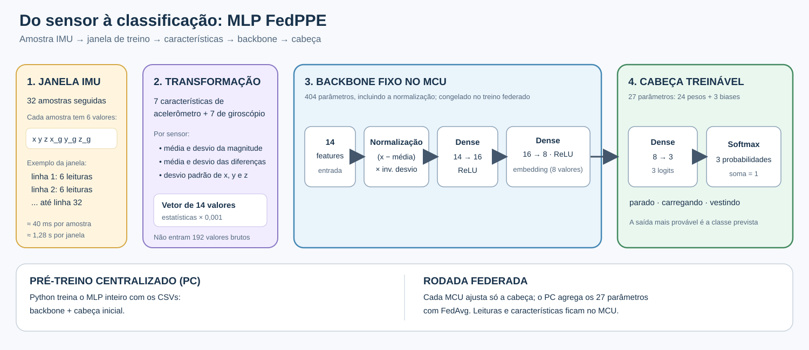
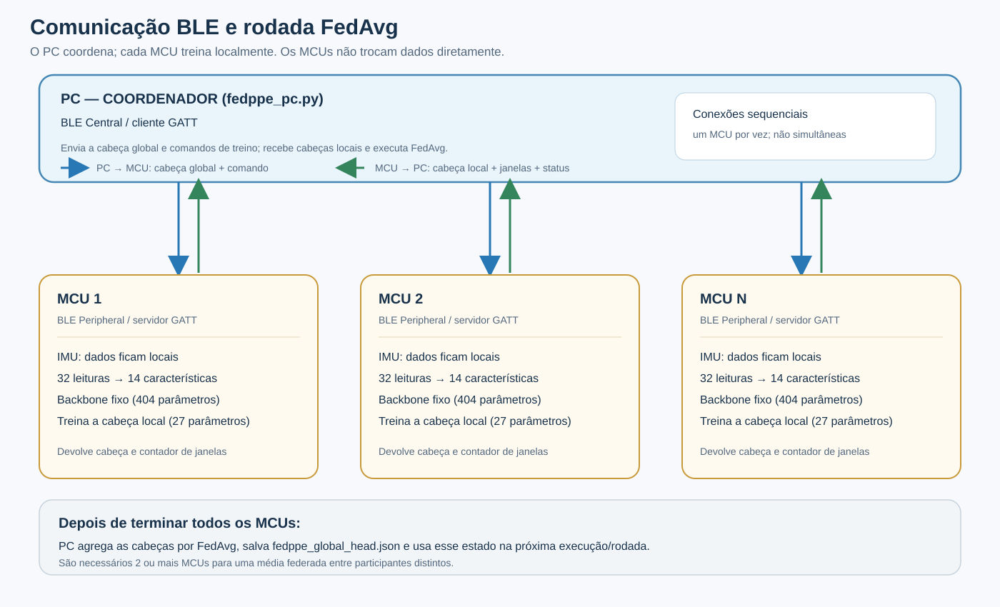

# TCC 001 - FedPPE: treinamento e teste

Este README descreve como reproduzir o treinamento inicial do modelo, preparar
o firmware e executar o fluxo de aprendizado federado entre o PC e os MCUs.
O projeto é um protótipo experimental baseado no exemplo Magic Wand da Silicon
Labs. A aplicação ativa é o fluxo FedPPE descrito aqui; o código original do
Magic Wand ainda existe em `magic_wand.cc`, mas não é a implementação usada
nesse fluxo.

## 1. Visão geral: quem treina o quê?

O treinamento acontece em duas etapas, em lugares diferentes:

1. **Treinamento inicial centralizado no PC:** o script Python treina a rede
   MLP inteira a partir dos CSVs. O resultado fornece o *backbone* e uma
   cabeça inicial.
2. **Treinamento local e federado:** o backbone fica congelado no firmware.
   Cada MCU atualiza localmente apenas a cabeça usando dados do próprio IMU e
   rótulos informados manualmente. O PC recebe as cabeças locais e executa
   FedAvg para produzir a próxima cabeça global.

```text
CSV rotulados
    |
    v
PC: treino inicial do MLP inteiro em Python
    |                         \
    | backbone                 \ cabeça inicial (27 parâmetros)
    v                            v
firmware compilado            PC/coordenador BLE
    |                            |
    |                       envia a cabeça global
    v                            v
encoder congelado          MCUs treinam localmente a cabeça
                                 |
                                 v
                       PC agrega as cabeças com FedAvg
                                 |
                                 v
                    fedppe_global_head.json (próxima rodada)
```

O script de treinamento usa a biblioteca padrão do Python, com operações
numéricas implementadas no próprio código; não depende de TensorFlow, PyTorch
ou scikit-learn. A comunicação BLE usa a biblioteca `bleak`. A comunicação
serial opcional usa `pyserial`.

## 2. Arquitetura da rede

```text
14 características -> 16 neurônios ReLU -> 8 valores embedding ReLU
                   -> 3 saídas softmax
```

- **Entrada:** 14 características estatísticas, calculadas a partir de uma
  janela de 32 leituras do IMU.
- **Backbone/encoder:** camadas `14 -> 16 -> 8`, incluindo os valores de
  normalização da entrada. O firmware contém 404 parâmetros do backbone e não
  os atualiza durante o treino local.
- **Cabeça/classificador:** camada `8 -> 3`, com 24 pesos e 3 biases (27
  parâmetros no total). As três saídas correspondem a `parado`, `carregando`
  e `vestindo`.



O diagrama mostra também o caminho dos dados: uma janela IMU é transformada
em 14 características; elas passam pelo backbone fixo e chegam à cabeça
treinável.

O PC envia somente os 27 parâmetros da cabeça aos MCUs. O backbone fica no
firmware e sua impressão digital (*fingerprint*) é comparada com a do modelo
JSON antes do treino. Isso evita treinar uma cabeça usando um encoder diferente
do esperado.

### Redes presentes no repositório e seu estado

| Rede | Estrutura identificada | Estado no projeto | Usada pelo FedAvg BLE atual? |
|---|---|---|---|
| **MLP FedPPE** | `14 -> 16 -> 8 -> 3`, ReLU nas camadas internas e softmax nas três classes. | É o fluxo ativo: o Python treina o modelo inicial; o firmware usa o backbone congelado e treina a cabeça. | **Sim.** É a única arquitetura integrada ao `ble-fedavg` descrito neste README. |
| **CNN 1D experimental** | Janela temporal de 32 leituras, 6 canais do IMU, 2 filtros de tamanho 3, ReLU, média temporal e uma saída sigmoid binária (`parado`/`mexendo`). | Há implementação em [`ml_demo_leo.c`](./ml_demo_leo.c), selecionável nesse demo como `model cnn`, mas não é chamada pelo fluxo ativo de [`app.c`](./app.c). | **Não.** Não está conectada ao protocolo BLE FedAvg nem à agregação feita por `fedppe_pc.py`. |
| **Classificador linear experimental** | 14 características estatísticas, uma saída sigmoid binária (`parado`/`mexendo`). | Também existe no demo [`ml_demo_leo.c`](./ml_demo_leo.c), como alternativa `model linear`; não é o MLP FedPPE. | **Não.** O modo experimental pode imprimir os parâmetros pela serial, mas não usa a agregação FedAvg BLE atual. |
| **Modelo legado Magic Wand/TFLite Micro** | Modelo TFLite Micro pré-gerado, associado ao código [`magic_wand.cc`](./magic_wand.cc). | Código legado presente, mas não é iniciado pelo `app_init`/`app_process_action` atual, que executa `fedppe_mcu_init`/`fedppe_mcu_process`. | **Não.** Não participa do treinamento ou transporte FedPPE. |
| **BiLSTM** | Rede recorrente LSTM bidirecional. | **Não implementada** no fluxo FedPPE nem encontrada como arquitetura no código do projeto. | **Não.** Para incluí-la seria necessário implementar e treinar a arquitetura, além de integrá-la ao firmware e ao protocolo/avaliação federada. |

**Importante sobre a CNN:** não é correto dizer que não existe nenhum código
de CNN no repositório. Existe uma CNN 1D experimental em `ml_demo_leo.c`.
Porém, ela está separada do aplicativo ativo e não participa da experiência
FedAvg BLE documentada aqui. Assim, se a comparação acadêmica exigir MLP,
CNN e BiLSTM no **mesmo fluxo federado**, a CNN ainda precisa ser integrada e
a BiLSTM precisa ser implementada.

## 3. Como o conjunto de dados é lido

O comando `train-backbone` aceita:

- Um arquivo ZIP, por exemplo `nn_offline_training-main.zip`; ou
- Um diretório já extraído com os CSVs.

Os três CSVs brutos necessários já estão organizados neste projeto:

```text
data/
└── Helmet/
    ├── still/output.csv
    ├── carrying/output.csv
    └── wearing/output.csv
```

Assim, a partir da pasta do projeto, passe `--dataset data` para treinar usando
esses arquivos. Também é possível informar outro ZIP ou diretório.

Para o EPI `Helmet` (valor padrão), o script procura as classes:

| Rótulo no modelo | Pasta no conjunto de dados | ID enviado ao MCU |
|---|---|---:|
| parado | `still` | 0 |
| carregando | `carrying` | 1 |
| vestindo | `wearing` | 2 |

Cada `output.csv` precisa ter as colunas `x`, `y`, `z`, `x_g`, `y_g` e `z_g`.
São lidas 32 linhas consecutivas por janela, sem sobreposição. Linhas finais
que não completam uma janela são descartadas.

### O que é uma amostra e o que é uma janela?

- **Amostra bruta:** uma leitura do IMU. Ela contém seis valores: aceleração
  nos eixos `x`, `y`, `z` e giroscópio nos eixos `x_g`, `y_g`, `z_g`.
- **Janela:** um grupo de 32 amostras brutas consecutivas. Portanto, antes do
  processamento, uma janela tem formato `32 × 6` (192 valores). As janelas não
  se sobrepõem: cada leitura entra em apenas uma janela. No firmware, a taxa
  nominal é uma leitura a cada 40 ms, então uma janela cobre cerca de 1,28 s.
- **Exemplo de treinamento da MLP:** uma janela inteira, depois de transformada
  em 14 características e associada a um rótulo de classe. A MLP não recebe os
  192 valores brutos como suas entradas.

No treinamento local, o MCU lê 32 amostras, calcula as características e faz
uma atualização da cabeça com o rótulo selecionado para aquela coleta. Por
isso, embora algumas variáveis do protocolo se chamem `samples`, o contador
usado pelo FedAvg representa **janelas de treinamento processadas**, não
leituras individuais do IMU.

### Que transformações são aplicadas?

Para cada trio de eixos (acelerômetro e, separadamente, giroscópio), o código
calcula sete valores:

1. Média da magnitude 3D, em que magnitude é
   `sqrt(x² + y² + z²)`.
2. Desvio-padrão da magnitude.
3. Média da mudança entre leituras consecutivas: calcula a diferença entre os
   três eixos de leituras vizinhas, obtém sua magnitude e tira a média das 31
   diferenças.
4. Desvio-padrão dessas magnitudes de diferença.
5. Desvio-padrão do eixo `x`.
6. Desvio-padrão do eixo `y`.
7. Desvio-padrão do eixo `z`.

O acelerômetro fornece sete características e o giroscópio fornece outras
sete, formando um vetor com **14 características**. Cada característica é
multiplicada por `0.001`. Depois, antes de entrar nas camadas densas, é
normalizada usando a média e o desvio-padrão aprendidos no conjunto de treino:

```text
entrada_normalizada[j] = (característica[j] - média_treino[j]) × inverso_desvio_treino[j]
```

Essa mesma extração e normalização é usada no PC e no firmware. Não é aplicada
transformada de Fourier nem sobreposição de janelas neste fluxo: as leituras
são resumidas pelas estatísticas acima e então normalizadas. A sequência é:

```text
32 amostras × 6 canais
        -> 14 estatísticas (× 0.001)
        -> normalização z-score
        -> entrada da MLP
```

No Python, o mapeamento e a extração estão em `CLASS_TO_FOLDER`,
`parse_csv_stream`, `sensor_features` e `extract_features` em
[`fedppe_pc.py`](./fedppe_pc.py). O firmware replica os cálculos em
`compute_features` e `compute_sensor_features` em [`fedppe_mcu.c`](./fedppe_mcu.c).

## 4. Treinamento inicial do modelo no PC

### Requisitos

- Python 3 instalado e disponível pelo launcher `py`.
- O arquivo ZIP ou diretório do conjunto de dados com a estrutura descrita
  acima.
- Não é necessário instalar biblioteca de aprendizado de máquina para este
  treinamento.

Abra o PowerShell na pasta deste projeto e execute:

```powershell
py fedppe_pc.py train-backbone --dataset "data" --ppe Helmet --epochs 30 --learning-rate 0.01 --seed 7 --output fedppe_mlp.json
```

Para treinar com uma cópia diferente do conjunto de dados, substitua `data`
em `--dataset` pelo caminho do ZIP ou do diretório extraído.

### O que o comando faz

1. Carrega os CSVs e converte as leituras em janelas rotuladas.
2. Separa as janelas: uma em cada cinco vai para validação; as demais vão para
   treinamento.
3. Calcula a média e o desvio-padrão das características usando somente o
   conjunto de treinamento.
4. Inicializa e treina o MLP por 30 épocas. Em cada época, embaralha as janelas
   de treinamento e atualiza os pesos exemplo a exemplo por retropropagação e
   descida do gradiente.
5. Ao final de cada época, calcula e imprime a acurácia no conjunto de
   validação, se houver janelas de validação.
6. Salva `fedppe_mlp.json` com metadados, backbone, cabeça inicial e quantidade
   de janelas usadas em treino e validação.

Os valores acima são os padrões do script: 30 épocas, taxa de aprendizado
`0.01` e semente aleatória `7`. A semente torna a inicialização e o
embaralhamento repetíveis quando o conjunto de dados e a ordem de leitura são
os mesmos.

### O que deve aparecer

Durante o treinamento, uma linha por época, por exemplo:

```text
epoch=1/30 validation_accuracy=...
...
epoch=30/30 validation_accuracy=...
Modelo salvo em fedppe_mlp.json
janelas treino=... validação=...
backbone=404 parâmetros; cabeça inicial=27
```

A acurácia mostrada é a acurácia de validação do treinamento inicial no PC. Ela
não é a acurácia de uma rodada FedAvg nem uma avaliação final em novos
participantes.

## 5. Exportar o backbone e atualizar o firmware

Depois de gerar o modelo, exporte o backbone como cabeçalho C:

```powershell
py fedppe_pc.py export-backbone --model fedppe_mlp.json --output fedppe_backbone.h
```

O cabeçalho contém a normalização, os pesos e biases do encoder e a
fingerprint. O firmware inclui `fedppe_backbone.h`. Portanto, ao trocar o
modelo inicial, confirme que o arquivo exportado está no local usado pelo
projeto, recompile e regrave o firmware no kit.

No Simplicity Studio 6:

1. Abra `aiml_soc_magic_wand_baremetal.slcp`.
2. Se a configuração BLE/GATT mudou, salve e regenere o projeto.
3. Faça o build do firmware e grave-o no MCU conectado.
4. Confirme que o firmware iniciado anuncia `TCC001-BLE`.

O arquivo compilado presente neste workspace é
`cmake_gcc\build\base\tcc_001.hex`; use uma imagem atualizada após o build. Se
o JSON e o firmware tiverem backbones diferentes, o cliente Python interrompe
a conexão FedAvg com erro de incompatibilidade de fingerprint.

## 6. Teste de comunicação BLE por eco

O teste de eco valida comunicação BLE, mas **não treina o modelo**. Instale
`bleak` e execute:

```powershell
py -m pip install bleak
py fedppe_ble_test.py
```

O PC procura o dispositivo `TCC001-BLE`, conecta, envia a mensagem
`ping-tcc001` e verifica se o MCU devolve os mesmos bytes por notificação. O
resultado esperado começa com `PASS`.

É possível selecionar o endereço do MCU e uma mensagem:

```powershell
py fedppe_ble_test.py --address AA:BB:CC:DD:EE:FF --message "teste 123"
```

A mensagem do teste de eco deve ter entre 1 e 20 bytes UTF-8. Um dongle BLE
precisa ser reconhecido pelo Windows como adaptador Bluetooth Low Energy; um
dongle que disponibiliza somente uma porta serial não é necessariamente
compatível com a biblioteca `bleak`.

## 7. Tipo de comunicação BLE e dados transmitidos

O transporte usado pelo fluxo federado é **Bluetooth Low Energy (BLE), com
GATT**. Não é uma conexão Wi-Fi, TCP/IP, MQTT ou comunicação pela nuvem.

- **PC:** atua como coordenador, dispositivo BLE central e cliente GATT. Ele
  procura e conecta-se aos MCUs.
- **MCU:** atua como periférico BLE e servidor GATT. Ele anuncia o nome
  `TCC001-BLE`, recebe escritas do PC e envia notificações.
- **Topologia:** um PC coordena um ou mais MCUs. As conexões com vários MCUs
  são feitas **sequencialmente**, um dispositivo por vez, não em paralelo.



O PC envia a mesma cabeça global inicial a cada MCU, um por vez. Cada MCU
treina localmente e devolve sua cabeça e o número de janelas usadas. Depois de
receber os resultados de todos, o PC calcula o FedAvg e salva o estado para a
próxima execução. Não há comunicação direta entre os MCUs.

O serviço GATT do projeto tem UUID
`f3641400-00b0-4240-ba50-05ca45bf8abc`. Ele contém estas características:

| Característica | UUID | Uso |
|---|---|---|
| `PC to MCU` | `f3641401-00b0-4240-ba50-05ca45bf8abc` | Escrita de comandos e dados do PC para o MCU. |
| `MCU to PC` | `f3641402-00b0-4240-ba50-05ca45bf8abc` | Notificações de resposta do MCU para o PC. |

As características foram criadas para o eco BLE e são reutilizadas pelo
protocolo FedAvg. No eco, o PC envia texto simples e verifica se recebe os
mesmos bytes de volta. No FedAvg, os dados são mensagens binárias com operações
e parâmetros definidos pelo projeto.

### Informações e variáveis do protocolo FedAvg

| Direção | Dados | Significado |
|---|---|---|
| PC → MCU | 27 floats de 32 bits: 24 pesos da cabeça (`wh`, formato 3×8) e 3 biases (`bh`) | Cabeça global que inicializa a parte treinável do MCU. |
| PC → MCU | `label` (classe), `windows` (quantidade de janelas) e `reset_sample_count` (flag) | Comando para iniciar treino local de uma classe. IDs: 0=`parado`, 1=`carregando`, 2=`vestindo`. |
| MCU → PC | Versão do protocolo, quantidade de parâmetros do backbone/cabeça, contador de janelas, estado de treino e fingerprint do backbone | Status e verificação de compatibilidade do firmware. |
| MCU → PC | Contador de janelas e os 27 floats da cabeça local | Resultado do treino local que o PC usa para o FedAvg. |
| Ambos os sentidos | Código da operação, identificador de transação, posição e tamanho da mensagem | Campos de controle para separar e remontar mensagens BLE fragmentadas. |

As operações do protocolo são `STATUS` (consultar status), `SET_HEAD`
(carregar cabeça global), `TRAIN` (iniciar treino local) e `GET_HEAD` (baixar
a cabeça local). O valor `windows` conta janelas de treino — cada janela
contém 32 leituras do IMU — e não leituras individuais do sensor.

Detalhes dos payloads FedAvg (sem contar o byte de estado da resposta):

- `STATUS`: o pedido não tem dados; a resposta útil tem 42 bytes: versão do
  protocolo (1), contagem de parâmetros do backbone (2), contagem da cabeça
  (2), janelas processadas (4), flag de treino (1) e fingerprint ASCII (32).
- `SET_HEAD`: 27 valores `float32` little-endian, total de 108 bytes.
- `TRAIN`: 6 bytes no formato `<BIB`: `label` (1 byte), `windows` (4 bytes
  little-endian) e `reset_sample_count` (1 byte).
- `GET_HEAD`: o pedido não tem dados; a resposta útil contém o contador de
  janelas (4 bytes) e 27 valores `float32` little-endian (108 bytes), total de
  112 bytes.

Cada quadro FedAvg tem um cabeçalho de cinco bytes e até 15 bytes de dados:

```text
[0xA5 | operação | transação | offset | tamanho_total | até 15 bytes de dados]
```

Mensagens maiores são divididas em quadros e remontadas no destino. As respostas
identificam a operação como resposta e incluem um estado de sucesso ou erro.
O cabeçalho organiza o transporte; não é uma variável do modelo.

**Os dados brutos permanecem no MCU:** leituras do IMU, características das
janelas, embeddings e backbone não são enviados pelo protocolo FedAvg. O
backbone de 404 parâmetros já está compilado no firmware. O MCU calcula as
características e treina localmente; o PC recebe somente status, contagem de
janelas e parâmetros da cabeça local. As probabilidades de classificação
também não fazem parte da mensagem de agregação FedAvg.

## 8. Uma rodada FedAvg via BLE

### Com um MCU: teste ponta a ponta

Com `bleak` instalado e o firmware compatível gravado, execute:

```powershell
py fedppe_pc.py ble-fedavg --windows-per-class 10 --model fedppe_mlp.json --state experimento_01.json
```

Sem `--addresses`, o programa procura um MCU chamado `TCC001-BLE`. Quando
solicitado, posicione o MCU no estado indicado e pressione Enter. O programa
coleta as classes em sequência: `parado`, `carregando` e `vestindo`.

Com dez janelas por classe, cada MCU faz 30 atualizações locais da cabeça por
rodada. Cada janela reúne 32 leituras do IMU e representa um exemplo rotulado.
O MCU envia a cabeça local e a contagem de janelas ao PC ao terminar.

Uma rodada com um MCU verifica a comunicação, o treino local e o salvamento do
estado, mas não demonstra a média entre vários participantes: a média de um
único modelo é igual ao próprio modelo.

### Com dois ou mais MCUs: agregação entre participantes

Informe os endereços BLE dos MCUs na mesma execução:

```powershell
py fedppe_pc.py ble-fedavg --addresses AA:BB:CC:DD:EE:FF 11:22:33:44:55:66 --windows-per-class 10 --model fedppe_mlp.json --state experimento_01.json
```

O PC conecta-se aos dispositivos **um de cada vez**. Para cada MCU, envia a
mesma cabeça global inicial daquela rodada, orienta o treino das três classes
e recebe a cabeça local. Depois que todos os clientes terminam, o PC calcula,
para cada parâmetro `j`:

```text
global[j] = soma_k(janelas_k * local_k[j]) / soma_k(janelas_k)
```

Com o mesmo número de janelas por MCU, isso equivale à média simples das
cabeças locais. O código de agregação está na função `fedavg` de
[`fedppe_pc.py`](./fedppe_pc.py).

### O que observar

- `Cliente BLE 1/N`, `Cliente BLE 2/N` etc. mostram a ordem dos MCUs.
- O programa pede que o operador coloque cada MCU no estado correspondente a
  cada classe.
- Após cada classe, o programa informa que o treino local terminou.
- Ao concluir todos os clientes, aparece a mensagem `Rodada BLE FedAvg
  concluída` e o estado global é salvo no arquivo informado por `--state`.
- Com os parâmetros padrão, o arquivo é `fedppe_global_head.json`.

Cada execução do comando é **uma rodada**; o programa não repete rodadas
automaticamente. Se o arquivo passado em `--state` já existir, o próximo
comando carrega a cabeça agregada nele e começa a rodada seguinte a partir
dela. Para um experimento novo, use um novo nome de arquivo de estado. Todos
os MCUs de uma rodada recebem a mesma cabeça global inicial antes do treino
local.

## 9. Comunicação serial alternativa

O modo serial é uma alternativa para interagir com um MCU pela porta VCOM. Ele
usa `pyserial`:

```powershell
py -m pip install pyserial
py fedppe_pc.py serial --port COM12 --model fedppe_mlp.json --state fedppe_global_head.json
```

Troque `COM12` pela porta COM virtual do kit e feche outros programas que
estejam usando essa porta. A taxa padrão é 115200 baud. No prompt interativo:

- `train CLASSE JANELAS`: coleta exemplos de uma classe (`0`, `1` ou `2`);
- `dump`: mostra os parâmetros da cabeça local;
- `infer`: consulta o estado do MCU; esse comando não inicia uma inferência
  sob demanda;
- `quit`: encerra a sessão.

O modo serial é voltado à interação manual com um MCU; use `ble-fedavg` com
dois ou mais endereços para testar a agregação entre participantes BLE.

## 10. Reprodutibilidade e limites do protótipo

- Para reproduzir o treinamento inicial, registre a versão exata dos CSVs, o
  caminho/organização dos arquivos, `--ppe`, `--epochs`,
  `--learning-rate` e `--seed`.
- A validação atual seleciona cada quinta janela da lista carregada. Como as
  janelas podem vir de uma mesma gravação, essa divisão não garante separação
  por pessoa, sessão ou arquivo. Para uma avaliação acadêmica independente,
  considere uma divisão por participante ou gravação e documente essa
  alteração.
- O treinamento BLE depende dos movimentos capturados pelo IMU e dos rótulos
  escolhidos manualmente. Só o repositório de CSVs não reproduz as cabeças
  locais obtidas em uma rodada física.
- O protótipo não faz conexões BLE simultâneas, rotulagem automática por
  sensor Hall, pseudo-rotulagem nem avaliação automática da acurácia após
  FedAvg.
- O backbone é treinado inicialmente no PC, mas fica congelado no MCU. O
  aprendizado local e a atualização federada modificam somente os 27
  parâmetros da cabeça.
